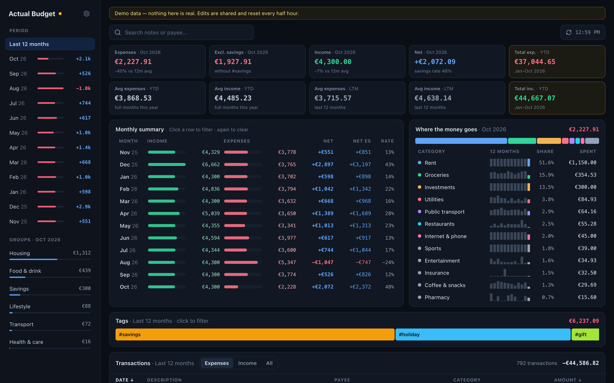
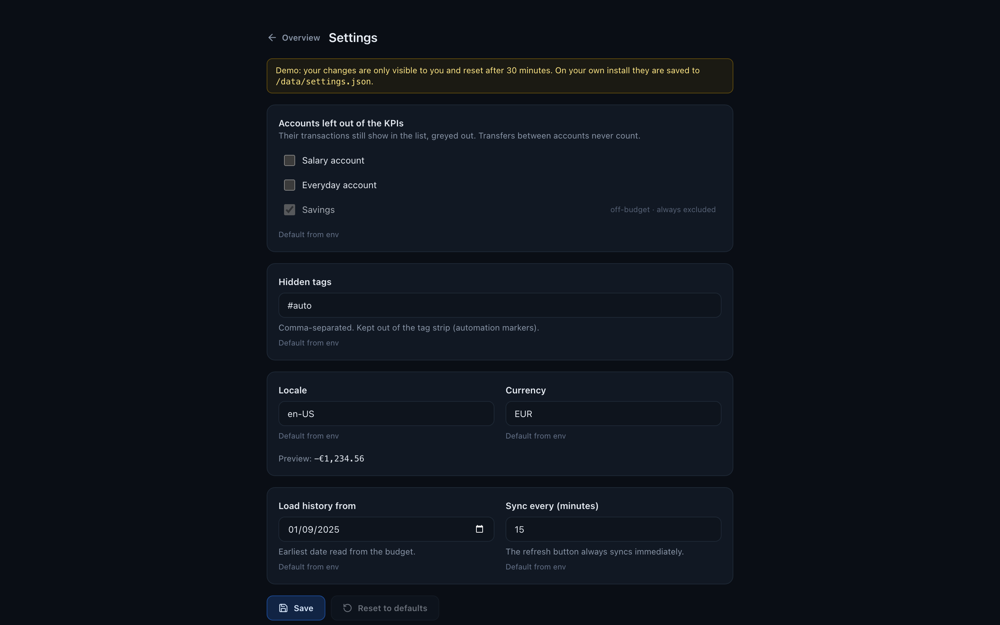

# ActualBudget Overview Dash

A self-hosted overview dashboard for [Actual Budget](https://actualbudget.org): KPIs for the month,
a 12-month summary, where the money goes by category, tags, and an editable transaction list.
Everything filters client-side, so clicking a month, a category or a tag is instant.

One container. It embeds the official `@actual-app/api` package, so it talks to your actual-server
directly: no extra API service, no database.

> Not affiliated with the Actual Budget project.

**Try the demo:** <https://actual-dash.marcecastro.com> (made-up data; your edits are private to you and reset after 30 minutes).



## Install

Create a `.env` file (see [`.env.example`](.env.example) for every option):

```env
ACTUAL_SERVER_URL=https://actual.example.com
ACTUAL_PASSWORD=your-actual-server-password
# Actual → Settings → Advanced settings → Sync ID
ACTUAL_SYNC_ID=00000000-0000-0000-0000-000000000000
DASH_PASSWORD=choose-a-dashboard-password
```

Then either:

```bash
docker run -d --name actualbudget-overview -p 3000:3000 --env-file .env \
  -v overview-data:/data ghcr.io/trastecc/actualbudget-overview-dash:latest
```

or use the included [`docker-compose.yml`](docker-compose.yml):

```bash
docker compose up -d
```

Open `http://<host>:3000`.

### Version matching

The bundled Actual API must match your actual-server's major version. Image tags follow Actual's
`YY.M` scheme: run `ghcr.io/trastecc/actualbudget-overview-dash:26.9` against actual-server 26.9.x.
`latest` is the newest release; `main` follows the main branch.

## Configuration

The gear icon opens the settings page: excluded accounts and categories, hidden tags, number format, history start and
sync interval. Changes apply at once and are saved to `/data/settings.json`. The environment
variables below are the defaults; **Reset to defaults** on the settings page goes back to them, and
headless setups can use env alone.



| Variable | Default | Meaning |
|---|---|---|
| `ACTUAL_SERVER_URL` | required | Your actual-server URL |
| `ACTUAL_PASSWORD` | required | Server password |
| `ACTUAL_SYNC_ID` | required | Budget Sync ID (Settings → Advanced settings) |
| `ACTUAL_E2E_PASSWORD` | unset | Only for end-to-end encrypted budgets |
| `ACTUAL_INSECURE_TLS` | `0` | `1` to accept a self-signed certificate |
| `DASH_PASSWORD` | unset | Dashboard login. Unset = no login screen (LAN-only) |
| `API_TOKEN` | unset | Bearer token for read-only `GET /api/summary` and `/api/overview` (see below) |
| `ACTUAL_DATA_DIR` | `/data` in the image | Budget cache and `settings.json` (mount a volume here) |
| `SYNC_INTERVAL_MIN` | `15` | Pull server changes every N minutes (the refresh button syncs now) |
| `EXCLUDED_ACCOUNTS` | unset | Accounts left out of KPIs, by name or id, comma-separated. Off-budget accounts are always excluded |
| `EXCLUDED_CATEGORIES` | unset | Categories left out of KPIs, by name or id, comma-separated (e.g. savings or investment contributions) |
| `HIDDEN_TAGS` | unset | Tags hidden from the tag strip (automation markers), comma-separated |
| `LOCALE` / `CURRENCY` | `en-US` / `EUR` | Number formatting |
| `HISTORY_SINCE` | 13 months ago | Earliest date loaded from the budget |
| `DEMO` | `0` | `1` serves a made-up budget, no Actual server needed (see below) |

Transfers between accounts and starting balances never count in the KPIs. A transfer to an off-budget
account that carries a category (a mortgage payment, a savings contribution) counts like any other
expense, as in Actual; leave the category out with `EXCLUDED_CATEGORIES` if it is money set aside
rather than spent. Transfers and excluded rows still appear in the list, greyed out.

## API for other dashboards

`GET /api/summary` returns the current month's income, expenses, net and averages as a small JSON
object, for widgets in Homepage, Glance and the like. With `DASH_PASSWORD` set, call it with
`Authorization: Bearer <API_TOKEN>`:

```bash
curl -H "Authorization: Bearer $API_TOKEN" http://<host>:3000/api/summary
```

`GET /api/health` is always open (Docker healthcheck).

## Demo mode

`DEMO=1` replaces your budget with generated data (14 months ending today, fixed seed): handy to
try the dashboard before pointing it at a server. Edits and settings stay in memory, apply only to the
visitor who made them (a browser cookie), and reset after 30 minutes.

```bash
docker compose -f docker-compose.demo.yml up -d
```

## Development

```bash
cp .env.example .env.local   # fill in your server
npm install
npm run dev
```

`npm run build` produces a standalone Next.js server; the [`Dockerfile`](Dockerfile) packages it.

## Contributing

See [CONTRIBUTING.md](CONTRIBUTING.md). Never include real budget data in issues or pull requests.

## License

[MIT](LICENSE). Built on [`@actual-app/api`](https://www.npmjs.com/package/@actual-app/api) (MIT).
